# Loop Device Experiments From The Linux Terminal

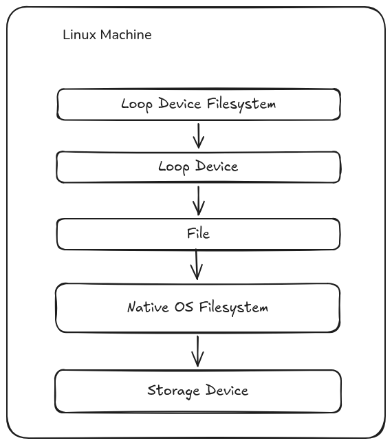

A loop device is a Linux feature where the block device interface is applied over a regular file to make it appear like a regular block device to the kernel. This block device can be used just like any other; installing a filesystem on it, partitioning it, mounting, storing data etc.<br>
The diagram above shows the structure of how this looks like. At the bottom we have the normal storage block device. A filesystem is installed on it for example ext4. Then there is a file inside the filesystem, it could be any tyoe of file from OS images to regular files. A loop device is attached to this file, creating another block device backed by that file. The loop device can be partitioned just like any other block device, then a filesystem is installed on it and it is used to store data like other storage devices.<br>
In the experiments below I will demonstrate how to create loop devices, partition and mount them, the nature of the backing files, resizing a loop device and its filesystem, how to fix corrupt devices etc.<br>
Before starting I first run the bash commands below to check is all the tools I will need later are available.

```bash
which losetup lsblk mkfs.ext4 mount umount truncate dd blockdev
```

If you're curious to understand what the tools do you can check their man pages. Then I list the available block devices using `lsblk`, only `/dev/nvme0n1` is available. I try inspecting the status information of all loop devices being used by `losetup -a` but it returns empty if there are none under active use. Using `losetup --find` shows the first unused loop device which is /dev/loop0.
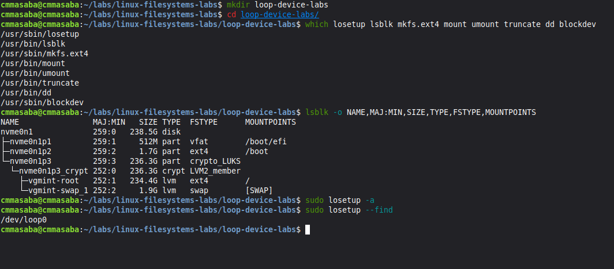

## 1. Creating and Mounting a Loop Device

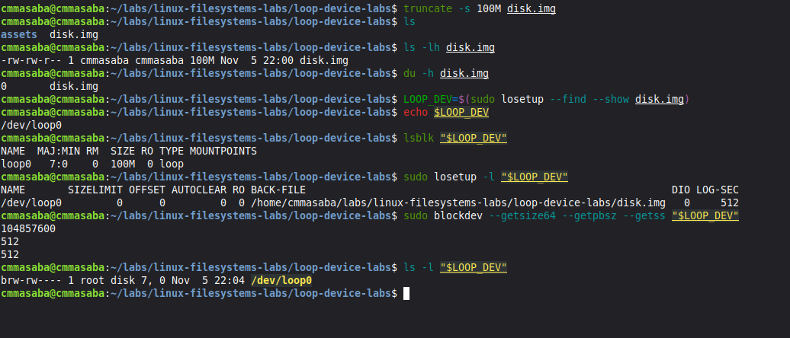

I create the backing file using `truncate` specifying a size of 100MiB and the disk name. Inspecting the file using `ls -lh` shows the file size is 100M whereas using `du -h` shows the file size is 0. This goes to show the difference between the logical and physical file sizes. The logical file size is 100M, it is what the filesystem reports. The physical size occupied by the file on disk is 0 because nothing has been written on it yet. The files created by `truncate` are a type of files called sparse files, more about them will be explained in the second experiment.<br>
I attach the next available loop device to the file created using the command `losetup --find --show disk.img`, it is attached to device /dev/loop0. `lsblk` shows the device type is loop and it is not yet mounted. `losetup -l /dev/loop0` shows additional info about the loop device for example the location of the backing file, the logical sector size, whether it is read only. I also use `blockdev` to inspect the total size of the loop device, the physical block size and the logical sector size. Finally, using `ls -l /dev/loop0` shows the device is identified as a block device.

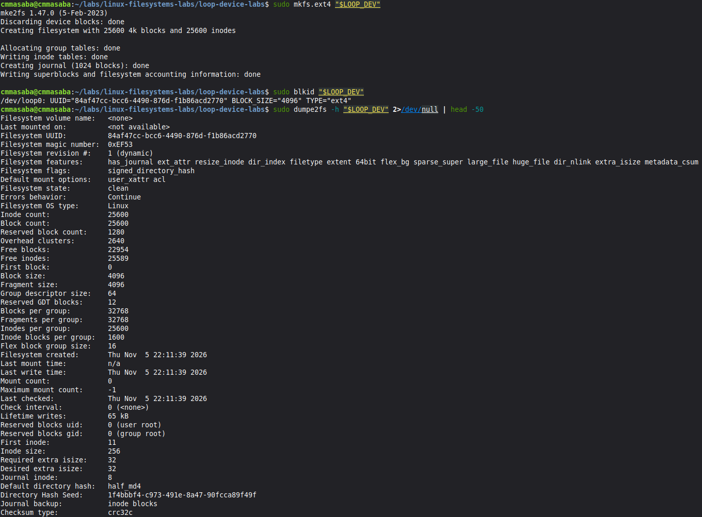
Next I create a ext4 filesystem on the loop device using. `sudo blkid /dev/loop0` shows the filesystem UUID and the type of filesystem. `sudo dumpe2fs -h /dev/loop0` shows ext4 filesystem information.

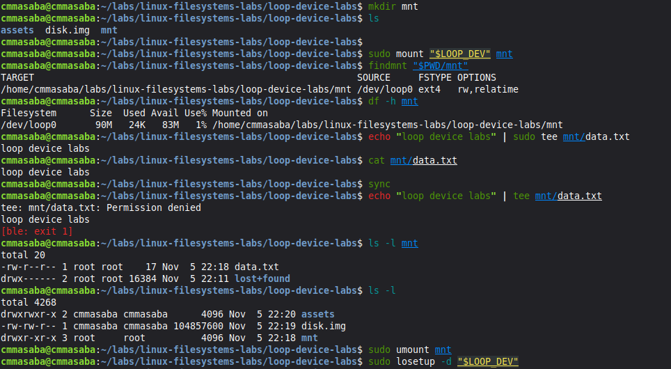
I mount the loop device under the `mnt` folder. `df -h mnt` shows the filesystem storage usage information. We see that the reported size is 90M instead of 100 and the available size is 83M, the filesystem uses part of the storage to store filesystem metadata which is why the reported sizes are smaller than would be expected. I write test data to the mounted filesystem and confirm it is saved before unmounting the filesystem and detaching the loop device.

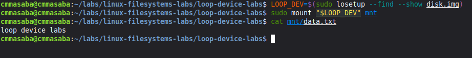
This last section shows that attaching a loop device to the same image and remounting the filesystem, the data created before is still available and readable.

## 2. Sparse Files

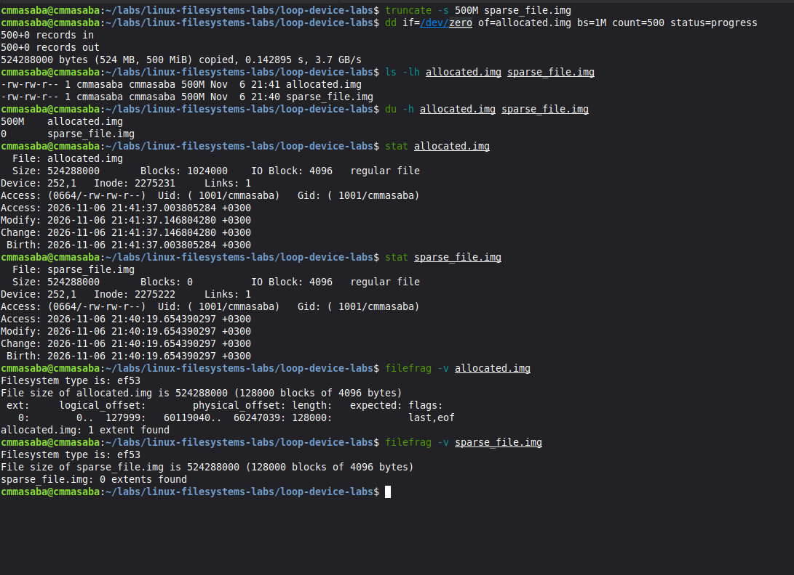
I create two types of files above both with size 500MiB, one using `truncate` and the other using `dd`. When I compare the two file sizes using `ls -lh` they both report size 500MiB. However when I use `du -h`, the file created using truncate reports disk usage is 0 while the other created using dd reports disk usage is 500MiB. The file created using truncate is a `sparse file` while the other one is an `allocated file`. Using stat on the two files reports the allocated file has data blocks while the sparse file has no data blocks. I also check the extent and fragmentation information of the two files using `filefrag`, the allocated file has 1 extent while the sparse file has none. Thus far we can see that, even though both files report a logical size of 500MiB, the allocated file occupies the same space physically while the sparse file occupies no space. In the remaining sections I will discuss what sparse files are, what their usecases are and some of the dangers associated with them.

### Sparse files, usecases & downsides

A sparse file is a type of computer file that attempts to use the filesystem more efficiently by writing only the metadata instead of actual blocks. In simpler terms, a sparse file pretends to be bigger than its actual size.<br>
When a normal empty file is created, the filesystem writes the zeroes directly on disk thus occupying space even if it is throwaway data. Sparse files uses the concept of `holes` to represent large segments of empty space. When an application writes meaningful data it saves it normally. When there are large segments of empty space, the filesystem just makes a note saying from block X to Y there nothing. When a program reads from a sparse file and encounters one of the holes, the filesystem intercepts the request and hands back zeroes, thus the program is under the illusion the data has been there all along.<br>
This results in a sparse file having two sizes, as we saww before. One of them is the virtual size the file claims to be (500MiB), and the other is the actual size of the file on disk (0MiB).<br>
Sparse files have important usecases in virtualization and large databases. It allows applications to use space more efficiently by reserving how much space they want upfront but do not reclaim it immediately and only filling it up as they go.

- virtual machine disks created using "dynamically allocating" feature start off as small sparse files and grow as you add data to the VM.
- docker and containers overlayfs uses sparse files to avoid consuming disk space before data is written
- databases reserve large address spaces for future tables but do not fill them right away with data

While sparse files are useful, they also come with some major downsides:

- overprovisioning: assuming you have a disk with 10G, a program can successfully create three sparse files of size 5GB each for different uses. When the program tries writing all the three files to their maximum capacity the disk suddenly runs out of space and the loop devices get `ENOSPC` even though their filesystem reports there is available space. This can result is filesystem crashes, corruption and data loss.
- fragmentation: sparse files tend to be highly fragmented because data blocks are allocated dynamically as data is written over time. On SSDs that support random I/O this is not very consequential but HDDs can suffer degraded performance due to the fragmentation.

### Enterprise-level: Thin vs Thick Provisioning

The concept of sparse files is applied to enterprise data storage virtualization by allocating space on demand instead of reserving space upfront, this practice is called thin provisioning. Instead of applying it to single files, thin provisioning is applied on entire cloud storage volumes or Storage Area Networks (SANs).<br>
Comparison of thin provisioning to the traditional approach of thick provisioning:

| Feature                | Traditional Thick Provisioning                                                                                 | Modern Thin Provisioning                                                                 |
| :--------------------- | :------------------------------------------------------------------------------------------------------------- | :--------------------------------------------------------------------------------------- |
| Allocation             | Space is allocated upfront and locked down.                                                                    | Space is allocated on demand as data is written and drawn from the shared storage pool.  |
| Utilization efficiency | Low utilization efficiency resulting in dead space since application rarely use up all the space they reserve. | High utilization efficiency since programs only use the space they require.              |
| Overprovisioning Risk  | Zero risk since the space the program reserved is always available.                                            | High risk if most application write data simultaneously and exceed the shared pool size. |

## 3. Partitioning

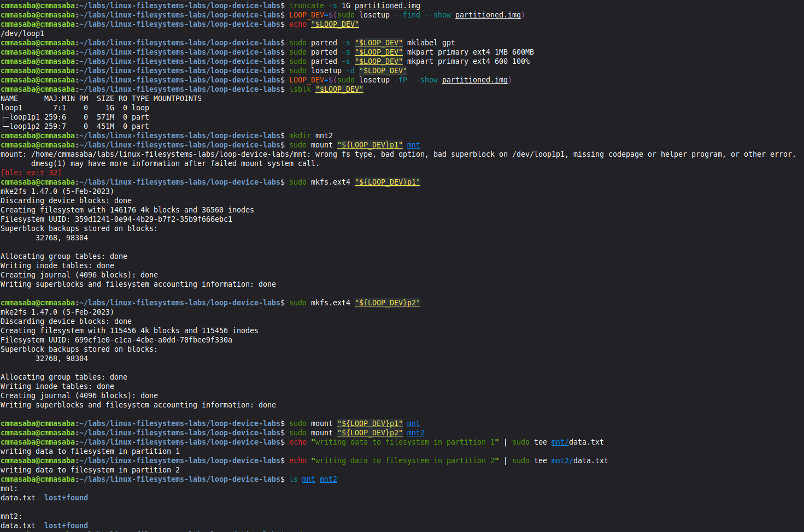

Partitioning is the process of subdividing a large disk into smaller blocks. Just like any other block device, loop devices can also be partitioned. In this experiment I create a 1GB image and attach it to /dev/loop0. Using the `parted`(partition editor) tool I create a GPT style partition table on the disk. There are generally 2 types of partition tables, the traditional Master Boot Record (MBR) and the newer Globally Unique Identifier Partition Table (GPT). GPT keeps two partition tables, the primary GPT header stored at the very start of the disk and the secondary backup GPT header table stored at the end of the disk.<br>
I make 2 ext4 primary partitions on the disk then unmount the loop device and attach it again with -P option to reload the partition table. `lsblk` now shows two partitions under the loop device. The rest of the steps involve making ext4 filesystems on the partitions, mounting them and showing writes can be done on both partitions.
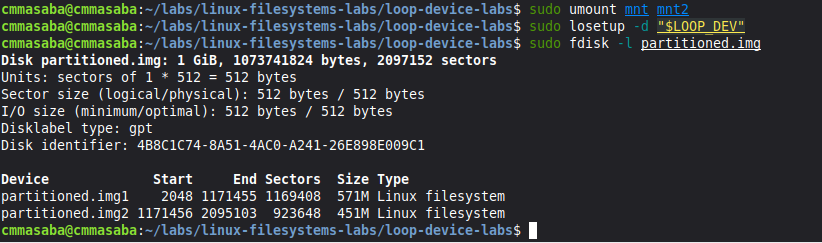
The GPT partition tables created can be viewed using the command `fdisk -l /dev/loop0`. THe output shows the partition style, the GUID and the partitions.

## 4. Resizing a loop device and its filesystem

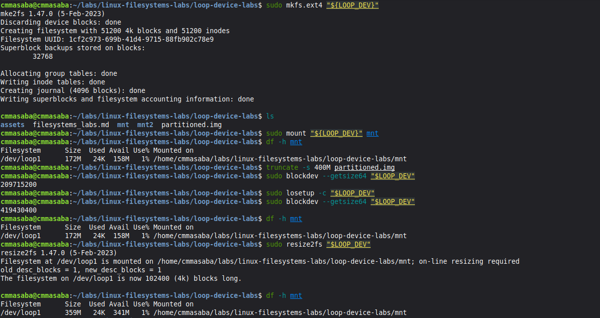
Since loop devices are backed by files, resizing the block device by expanding or shrinking the file is easy. Expanding the file and loop device size is can be done while the filesystem is mounted. First I increase the size using truncate, at this point even though the backing file size is increased, the loop device and filesystem still report the old size. I force the loop driver to reread the device's capacity using the `-c` option and the filesystem to reread the new changes using `resizefs`.

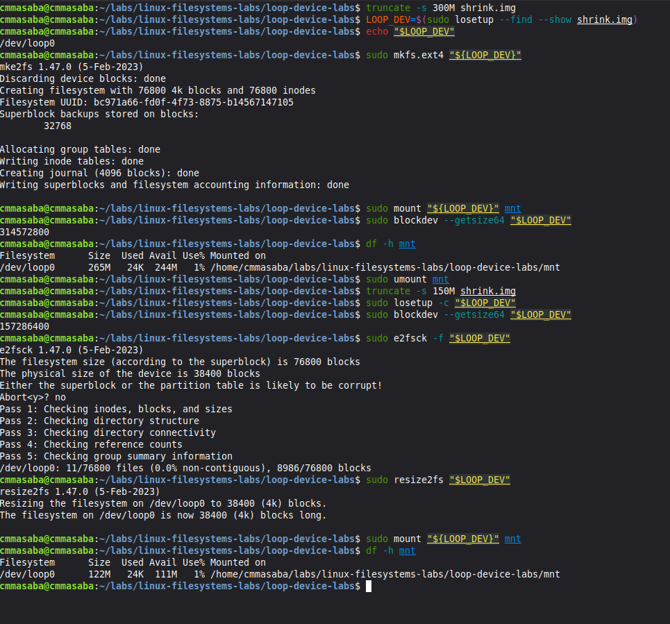
Shrinking the size of the loop device and filesystem is abit trickier. For this the fileystem must first be unmounted and the steps followed in a specific order. First I shrink the size of the file down then force the loop driver to reread the new device size. Next I run `e2fsck` which checks the filesystem status, running it with `-f` option forces checking even if the filesystem may be corrupted. Since the original image already had a filesystem before it was shrunk, e2fsck rightly reports the filesystem may be corrupted. We proceed despite the warning and all the 5 checks pass. Next we force the filesystem to record the new size. We can then mount and use the device again.

## 5. Read-only mode

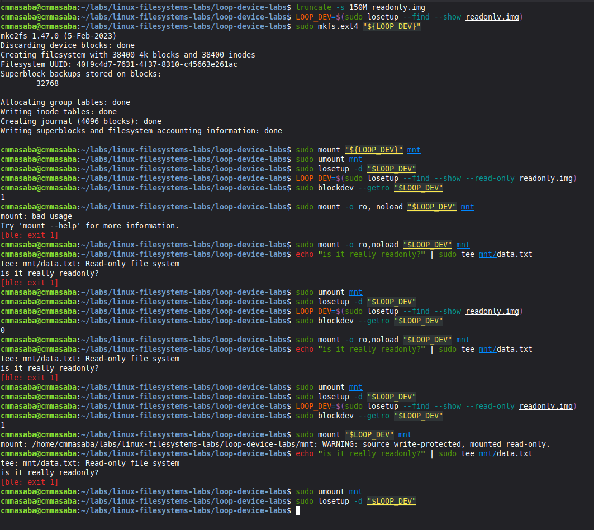
Read-only mode does not allow writing. It can be configured at two levels, when mounting the filesystem inside the loop device or when attaching the loop device to the file. I attach the loop device in read-only mode using the `--read-only` option of losetup. Then I mount the ext4 filesystem in read-noly mode using `ro,noload`; ro means read-only and noload means the ext4 journal should not be replayed on the filesystem, replaying the journal would have attempted writing on the filesytem as it is mounted. After this `blockdev --getro` reports the filesystem is read-only and any attempt to write to it fails with an error.<br>
I experiment with a loop device that allows read/write and a filesystem that supports read-only, the filesystem setting is respected and it blocks any writes. Another experiment is with a filesystem that supports read/write but a loop device that supports read-only and the loop device configuration is respected, blocking any writes.

## 6. Filesystem corruption and repair

